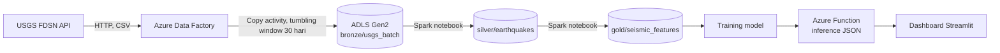

# TCBA — Ingesti Data Gempa USGS ke Azure Data Lake (Bronze)

Proyek akhir mata kuliah **Teknologi Cloud untuk Big Data dan Data Analitik**, Program Studi Sains Data, Universitas Sebelas Maret.

Topik proyek: **Sistem Prediksi dan Peringatan Dini Gempa Susulan** di atas Microsoft Azure.

Repo ini berisi lapisan **ingestion dan Bronze** yang sudah berjalan: Azure Data Factory menarik katalog gempa USGS secara otomatis dan menuliskannya ke Azure Data Lake Storage Gen2.

---

## 1. Status terhadap ketentuan proyek

### Ketentuan wajib

| Ketentuan | Status | Keterangan |
|---|---|---|
| Azure Data Factory sebagai pipeline otomatis | selesai | Tumbling window trigger, 126 jendela, seluruhnya Succeeded |
| Implementasi ML/DL di dalam pipeline | belum | Dikerjakan setelah Silver dan Gold siap |
| Retrain otomatis minimal 2 kali | belum | Butuh notebook training lebih dulu |
| Inference Azure Function berformat JSON | belum | Menyusul setelah model ada |

### Target bonus

| Target | Status | Keterangan |
|---|---|---|
| Data 100.000 baris | selesai | **298.930 baris** di Bronze |
| Kredit di bawah 80 dolar | terpantau | Budget alert 20 dolar per bulan, ambang 20/40/60/80/100 persen |
| Dashboard berisi hasil ML | belum | |
| Retrain lebih dari 3 kali | belum | |
| Konversi ke Parquet/ORC dan query Gold dari file hasil konversi | belum | |

---

## 2. Arsitektur



Yang sudah berjalan di repo ini hanya bagian `USGS -> ADF -> Bronze`. Sisanya rencana kerja tahap berikutnya dan digambarkan abu-abu pada laporan.

---

## 3. Sumber data

- Endpoint: `https://earthquake.usgs.gov/fdsnws/event/1/query`
- Format: CSV, 22 kolom, header disertakan
- Filter: magnitudo minimal **2.5**
- Rentang: **11 Juni 2016 s.d. 1 November 2026**
- Jendela: **30 hari** per permintaan

Jendela 30 hari dipilih karena API USGS membatasi sekitar 20.000 event per permintaan, sedangkan M>=2.5 global hanya sekitar 2.250 event per bulan. Dengan jarak yang lebar ini, tidak ada jendela yang berisiko terpotong.

### Kolom CSV

`time, latitude, longitude, depth, mag, magType, nst, gap, dmin, rms, net, id, updated, place, type, horizontalError, depthError, magError, magNst, status, locationSource, magSource`

Kolom `id` adalah kunci unik kejadian dari USGS dan dipakai untuk deduplikasi pada lapisan Silver.

---

## 4. Struktur data lake

Container: `datalake` pada storage account ber-HNS.

```
datalake/
└── bronze/
    └── usgs_batch/
        └── year=YYYY/
            └── dt=YYYY-MM-DD/
                └── events.csv
```

Satu berkas per jendela ingest. Partisi `dt=` memakai tanggal awal jendela, sehingga setiap ingest memiliki jejak yang tidak saling menimpa. Penggabungan berkas kecil dilakukan saat penulisan Silver, bukan di Bronze.

Folder lain yang sudah ada tetapi belum dipakai: `silver/`, `gold/`, `models/`, `inference/`, `checkpoints/`.

---

## 5. Aset Azure Data Factory

| Jenis | Nama | Berkas |
|---|---|---|
| Linked service | `ls_usgs` | `adf/linked-services/ls_usgs.json` |
| Linked service | `ls_datalake` | `adf/linked-services/ls_datalake.json` |
| Dataset sumber | `ds_usgs_csv` | `adf/datasets/ds_usgs_csv.json` |
| Dataset tujuan | `ds_bronze_csv` | `adf/datasets/ds_bronze_csv.json` |
| Pipeline | `pl_ingest_usgs` | `adf/pipelines/pl_ingest_usgs.json` |
| Trigger | `twr_usgs_30d` | `adf/triggers/twr_usgs_30d.json` |

### Alur parameter

Pipeline menerima empat parameter: `startDate`, `endDate`, `tahun`, `tanggal`. Trigger tumbling window mengisinya dari jendela waktu yang sedang diproses:

| Parameter | Ekspresi |
|---|---|
| `startDate` | `@formatDateTime(trigger().outputs.windowStartTime,'yyyy-MM-dd')` |
| `endDate` | `@formatDateTime(trigger().outputs.windowEndTime,'yyyy-MM-dd')` |
| `tahun` | `@formatDateTime(trigger().outputs.windowStartTime,'yyyy')` |
| `tanggal` | `@formatDateTime(trigger().outputs.windowStartTime,'yyyy-MM-dd')` |

URL sumber dibentuk di dalam Copy activity:

```
@concat('query?format=csv&starttime=', pipeline().parameters.startDate,
        '&endtime=', pipeline().parameters.endDate, '&minmagnitude=2.5')
```

---

## 6. Hasil yang sudah tercapai

| Metrik | Nilai |
|---|---|
| Jendela terproses | 126 |
| Jendela gagal | 0 |
| Berkas CSV di Bronze | 126 |
| Total baris data | **298.930** |
| Ukuran di lake | 65,1 MB |
| Biaya ADF untuk seluruh backfill | sekitar 0,6 dolar |

Verifikasi ulang dengan `scripts/verify_bronze.sh`.

---

## 7. Cara mereproduksi

Prasyarat: Azure CLI sudah login, resource group dan storage account sudah ada, dan identitas ADF memiliki role **Storage Blob Data Contributor** pada storage account.

```bash
RG=<resource-group>
FACTORY=<nama-data-factory>

az datafactory linked-service create -g $RG --factory-name $FACTORY \
  -n ls_usgs --properties @adf/linked-services/ls_usgs.json

az datafactory linked-service create -g $RG --factory-name $FACTORY \
  -n ls_datalake --properties @adf/linked-services/ls_datalake.json

az datafactory dataset create -g $RG --factory-name $FACTORY \
  -n ds_usgs_csv --properties @adf/datasets/ds_usgs_csv.json

az datafactory dataset create -g $RG --factory-name $FACTORY \
  -n ds_bronze_csv --properties @adf/datasets/ds_bronze_csv.json

az datafactory pipeline create -g $RG --factory-name $FACTORY \
  --name pl_ingest_usgs --pipeline @adf/pipelines/pl_ingest_usgs.json

az datafactory trigger create -g $RG --factory-name $FACTORY \
  -n twr_usgs_30d --properties @adf/triggers/twr_usgs_30d.json

az datafactory trigger start -g $RG --factory-name $FACTORY -n twr_usgs_30d
```

### Uji satu jendela tanpa trigger

```bash
az datafactory pipeline create-run -g $RG --factory-name $FACTORY \
  --name pl_ingest_usgs \
  --parameters '{"startDate":"2024-01-01","endDate":"2024-02-01","tahun":"2024","tanggal":"2024-01-01"}'
```

Hasil yang diharapkan: satu berkas 522 KB berisi 2.249 baris, sama dengan jumlah event M>=2.5 pada Januari 2024 menurut USGS.

---

## 8. Biaya

| Komponen | Perkiraan |
|---|---|
| ADF backfill 126 jendela | 0,6 dolar |
| ADLS Gen2, 65 MB | di bawah 0,01 dolar per bulan |
| Budget alert | gratis |

Komponen termahal pada proyek ini bukan penyimpanan dan bukan ADF, melainkan jam hidup Synapse Spark pool. Pool Small berukuran 4 vCore per node dengan minimum 3 node, sehingga biayanya sekitar 1,9 dolar per jam. Auto-pause 5 menit wajib aktif.

---

## 9. Struktur repo

```
.
├── README.md
├── adf/
│   ├── datasets/
│   ├── linked-services/
│   ├── pipelines/
│   └── triggers/
├── docs/
│   └── evidence.md
└── scripts/
    └── verify_bronze.sh
```

Data CSV tidak disimpan di repo karena berukuran 65 MB dan dapat dibuat ulang kapan saja dengan menyalakan trigger. Yang disimpan adalah definisi pipeline sehingga hasilnya reproducible.

---

## 10. Tim

| Nama | NID | Bagian |
|---|---|---|
| Adrian Farrel Aziz Yatyoga | L0224040 | Ingestion, ADF, Bronze |
| Zaki Elias Al Haqqani Kudus | L0224039 | Silver, Gold, query, dashboard |
| Nadhifa Sakha Tri Yasmin | L0224036 | ML, evaluasi, inference |
| Fathul Fajar Nur Ikshan | L0224018 | Platform Azure, RBAC, biaya, streaming |

---

## 11. Langkah berikutnya

1. Notebook Silver: pembersihan, pengetikan kolom, deduplikasi berdasarkan `id`.
2. Notebook Gold: fitur agregat per sel grid dengan rolling window 7/30/90 hari dan akumulasi energi Gutenberg-Richter.
3. Dataset berlabel gempa susulan dengan pemisahan waktu untuk mencegah kebocoran data.
4. Training model, evaluasi terhadap baseline hukum Omori, penyimpanan model berversi.
5. Trigger retraining memanggil notebook training, minimal dua kali otomatis.
6. Azure Function untuk inference berformat JSON.
7. Dashboard Streamlit berisi hasil prediksi.
