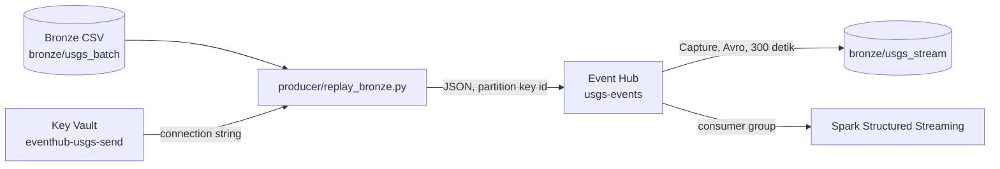

# Streaming: Putar Ulang Bronze ke Event Hub

Panduan menjalankan produser, batas laju, arti metric, dan penanganan galat. Skema event ada di `docs/event-schema.md`.

## 1. Untuk apa bagian ini

Data gempa yang sudah masuk Bronze diputar ulang sebagai aliran event ke Event Hub `usgs-events`. Tujuannya mensimulasikan data masuk terus-menerus tanpa sensor waktu nyata, sekaligus memberi Elias dan Kesan contoh event untuk menguji Spark dan Azure Function.

Alurnya:



## 2. Prasyarat

1. Azure CLI sudah login pada tenant dan langganan proyek.
2. Akun memiliki role **Key Vault Secrets User** atau lebih tinggi pada vault `kv-earthquake-l0224036`, dan **Azure Event Hubs Data Sender** pada namespace bila memakai identitas, bukan connection string.
3. Python 3.11 atau lebih baru, lalu:

```bash
cd /path/ke/repo
python3 -m venv .venv
.venv/bin/pip install -r producer/requirements.txt
```

4. Data Bronze tersedia lokal. Unduh sebagian saja, tidak perlu 65 MB penuh:

```bash
az storage blob download-batch \
  --account-name cloudearthquake --auth-mode login \
  -s datalake -d ./data/bronze \
  --pattern "bronze/usgs_batch/year=2024/*"
```

## 3. Menjalankan

Uji tanpa mengirim, untuk memastikan konversi JSON benar:

```bash
.venv/bin/python producer/replay_bronze.py \
  --source ./data/bronze --limit 300 --dry-run
```

Kirim 10.000 event:

```bash
.venv/bin/python producer/replay_bronze.py \
  --source ./data/bronze \
  --limit 10000 \
  --vault-url https://kv-earthquake-l0224036.vault.azure.net/ \
  --secret-name eventhub-usgs-send \
  --eventhub-name usgs-events \
  --log replay_10k.log
```

Seluruh pengaturan dapat dipindahkan ke variabel lingkungan, sehingga perintahnya pendek:

| Variabel | Isi | Bawaan |
|---|---|---|
| `KEY_VAULT_URL` | URL vault | kosong, wajib |
| `EVENTHUB_SECRET_NAME` | Nama secret connection string | `eventhub-usgs-send` |
| `EVENTHUB_NAME` | Nama hub tujuan | `usgs-events` |

| Opsi | Arti | Bawaan |
|---|---|---|
| `--source` | Berkas, direktori, atau pola glob. Boleh diulang | wajib |
| `--limit` | Jumlah event maksimum, 0 berarti semua | 0 |
| `--batch-size` | Event per putaran kirim | 100 |
| `--rate` | Batas laju event per detik | 200 |
| `--retries` | Percobaan ulang per event | 3 |
| `--dry-run` | Baca dan ubah ke JSON tanpa mengirim | mati |
| `--log` | Berkas log tambahan | hanya layar |

## 4. Batas laju dan alasannya

Namespace `earthquake-space` memakai satu throughput unit Standard. Batas masuknya sekitar 1 MB per detik dan 1.000 pesan per detik. Satu event di sini berukuran sekitar 330 byte, sehingga 200 event per detik hanya memakai sekitar 66 KB per detik, jauh di bawah batas, tetapi masih memberi ruang untuk lonjakan.

Produser menahan laju dengan menghitung waktu tempuh kumulatif, bukan dengan jeda tetap per event. Kalau jaringan melambat, laju mengikuti kecepatan sebenarnya tanpa menumpuk antrean.

Partition key adalah `id` kejadian. Dengan begitu semua versi satu kejadian, termasuk pembaruan `updated`, masuk ke partisi yang sama dan urutannya terjaga. Konsekuensinya, satu batch AMQP tidak dapat memuat 100 `id` berbeda, sehingga 100 event per putaran dikirim sebagai 100 pesan dengan kunci masing-masing.

## 5. Arti metric yang dipakai sebagai bukti

| Metric | Letak | Arti |
|---|---|---|
| `IncomingMessages` | Namespace, Metrics | Jumlah pesan yang diterima hub. Angka ini yang dicocokkan dengan jumlah event yang dikirim |
| `IncomingBytes` | Namespace, Metrics | Volume masuk, untuk memastikan ukuran per event wajar |
| `CapturedMessages` | Namespace, Metrics | Jumlah pesan yang sudah ditulis Capture ke storage |
| `ThrottledRequests` | Namespace, Metrics | Permintaan yang ditolak karena melebihi batas. Harus nol saat uji |
| Isi file Capture | `bronze/usgs_stream` | Cara paling pasti menghitung event unik. Baca kolom `Body` pada setiap baris Avro |

Ambil angka `IncomingMessages` satu jam terakhir:

```bash
az monitor metrics list \
  --resource $(az eventhubs namespace show -n earthquake-space -g Project-Cloud-Kelompok2 --query id -o tsv) \
  --metric IncomingMessages --interval PT1M --offset 1h \
  --aggregation Total -o table
```

Cocokkan dengan log produser. Pada uji 10.000 event, angka `IncomingMessages` harus sama dengan jumlah event yang dilaporkan log.

## 6. Capture

Capture sudah menyala pada hub `usgs-events` dengan pengaturan berikut.

| Pengaturan | Nilai |
|---|---|
| Encoding | Avro |
| Interval | 300 detik |
| Batas ukuran | 300 MB |
| Arsip kosong | dilewati |
| Pola folder | `bronze/usgs_stream/{Namespace}/{EventHub}/{PartitionId}/{Year}/{Month}/{Day}/{Hour}/{Minute}/{Second}` |

Karena intervalnya 300 detik, berkas Avro baru muncul sekitar lima menit setelah pengiriman berakhir. Kalau langsung memeriksa setelah kirim dan foldernya masih kosong, tunggu satu interval penuh sebelum menyimpulkan gagal.

Periksa isi folder:

```bash
az storage fs file list -f datalake --account-name cloudearthquake \
  --auth-mode login --path bronze/usgs_stream --recursive -o table
```

## 7. Galat yang umum

| Gejala | Sebab | Tindakan |
|---|---|---|
| `ClientAuthenticationError` saat membaca secret | Akun belum punya role pada vault, atau baru saja diberi dan belum menyebar | Tunggu lima menit, lalu ulangi. Minta pemilik vault menambah role **Key Vault Secrets User** |
| `UnauthorizedError` atau status 401 saat kirim | Connection string salah hub, atau kunci sudah dirotasi | Perbarui secret `eventhub-usgs-send` dengan connection string terbaru |
| `ServerBusyError` atau `ThrottlingError` | Laju melebihi kuota namespace | Turunkan `--rate`, misalnya ke 100 |
| `MessageSizeExceeded` | Satu event melebihi 1 MB | Tidak terjadi pada data USGS, ukuran normal sekitar 330 byte |
| `ConnectionLostError` | Jaringan terputus saat kirim | Skrip mencoba ulang tiga kali dengan jeda 1, 2, dan 4 detik. Event yang tetap gagal dicatat dan dilewati, skrip tidak berhenti |
| Proses hanya 7 event/detik, jauh di bawah 200 | Batas laju bukan penyebabnya. Setiap `send_event` menunggu konfirmasi server | Untuk uji ini wajar. Kalau butuh cepat, kirim per batch dengan satu partition key |
| Angka metric lebih besar dari jumlah kirim | Ada pengiriman lain pada rentang waktu yang sama, misalnya uji yang dihentikan | Hitung `id` unik dari file Capture, bukan dari metric |
| Folder Capture tetap kosong | Interval 300 detik belum lewat, atau Capture mati | Cek `captureDescription.enabled` pada hub, lalu tunggu satu interval |

## 8. Hasil uji

Isi bagian ini setelah uji dijalankan, dengan angka dari log dan metric.

| Hal | Nilai |
|---|---|
| Event dikirim | 10.000, semua berhasil, 0 gagal |
| Durasi | 1.358 detik, dari 14:27 sampai 14:50 UTC |
| Laju rata-rata | 7,4 event per detik |
| File Capture | 28 berkas Avro, 20.001 baris |
| `id` unik di Capture | 10.000 |
| Duplikat di Capture | 10.001, berasal dari uji pertama yang dihentikan pada 4.100 event |
| Field per event | 10, sesuai `docs/event-schema.md` |
| Waktu enqueue | 14:16 sampai 14:50 UTC |

Log tersimpan di `docs/replay_10k.log`. Screenshot metric dan daftar berkas Avro perlu diambil ke folder `docs/img/`.

Catatan: `IncomingMessages` tidak dipakai sebagai angka pembuktian. Metric itu menggabungkan dua percobaan kirim, sehingga totalnya 20.001 bukan 10.000. Pembuktian jumlah event memakai 10.000 `id` unik yang terbaca dari file Capture. Batas 200 event per detik tidak tercapai karena `send_event` menunggu konfirmasi server untuk setiap pesan. Nilai 7,4 event per detik masih jauh di bawah kuota namespace, sehingga tidak ada throttling.
